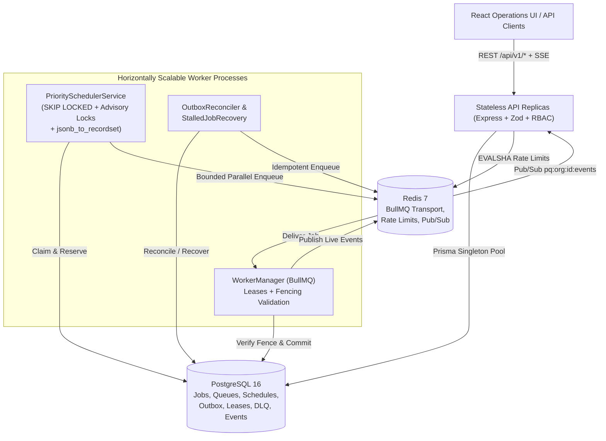

# PulseQueue

**PulseQueue** is a multi-tenant, distributed job processing and fair-scheduling platform built with TypeScript, Node.js, PostgreSQL (Prisma), Redis (BullMQ + Pub/Sub), and React.

It pairs a durable PostgreSQL control plane and custom multi-policy scheduler (`PrioritySchedulerService`) with a Redis/BullMQ execution transport, execution leases with monotonic fencing tokens, transactional outbox recovery, real-time SSE observability, and horizontally scalable API and worker processes.

---

## Problem Statement & Motivation

Standard Redis-backed job queues excel at low-latency FIFO dispatch, but struggle when multiple tenants share infrastructure under bursty, heterogeneous workloads:

- **Noisy-neighbor starvation:** A single high-volume tenant or high-priority stream can starve lower-priority or smaller tenants.
- **Lost writes & split-brain execution:** Dual-writing job state to a relational database and Redis without an outbox or fencing tokens causes ghost jobs, duplicate execution, or stale workers overwriting newer attempts after network partitions or crashes.
- **Lack of scheduling expressiveness:** Most queue engines cannot mix strict priority, starvation-preventing priority aging, cost-weighted Deficit Round-Robin (DRR), and Earliest Deadline First (EDF) scheduling with atomic multi-tenant concurrency reservations.

PulseQueue solves these problems by keeping **PostgreSQL as the single source of truth** for job state, scheduling decisions, quotas, leases, and audit events, while using **Redis and BullMQ** strictly as the high-speed worker dispatch transport, distributed rate-limiting store, and real-time event pub/sub layer.

---

## Key Capabilities & Engineering Highlights

- **Custom PostgreSQL Multi-Policy Scheduler:** Six scheduling policies (`FIFO`, `STRICT_PRIORITY`, `PRIORITY_AGING`, `WEIGHTED_FAIR` / DRR, `DEADLINE_AWARE` / EDF, `HYBRID_FAIR_DEADLINE`) plus `LEGACY_BULLMQ` direct-enqueue mode, powered by `FOR UPDATE SKIP LOCKED`, per-organisation PostgreSQL advisory locks, and single-statement batched `jsonb_to_recordset` claim updates.
- **Crash-Safe Dispatch & Fencing:** Transactional outbox + background reconciler guarantees no committed job is stranded; execution leases, heartbeats, stalled-job recovery, and monotonic fencing tokens prevent stale deliveries from executing or corrupting state.
- **Multi-Tenant Security & Governance:** Organisation-scoped RBAC (`OWNER`, `ADMIN`, `MEMBER`), JWT access tokens with rotating HttpOnly refresh tokens (atomic reuse-detection revocation), scoped HMAC-SHA256 tenant API keys (`pq_live_...`), Redis `EVALSHA` distributed rate limiting, and per-tenant quotas, retry budgets, backpressure, and poison-job quarantine.
- **Recurring & One-Time Scheduling:** Cron and one-time schedules with timezone/DST awareness, misfire policies, idempotent `@@unique([scheduleId, scheduledFor])` dispatch, and max-concurrency caps.
- **Real-Time Monitoring & Alerting:** Live dashboard, latency percentiles, scheduler policy/fairness/deadline observability, worker heartbeats, alert rules, in-app notifications, Dead Letter Queue (DLQ) replay, and Server-Sent Events (SSE) fanned out across API replicas via Redis Pub/Sub.
- **Horizontal Scaling & Bounded Shutdown:** Stateless API replicas and competing worker/scheduler OS processes verified in real multi-process integration tests, with 2-stage bounded graceful shutdown (`stopAndDrain` + deferred cleanup).

---

## Architecture & Technology Stack

| Layer                  | Technology                                                           | Role                                                                                     |
| ---------------------- | -------------------------------------------------------------------- | ---------------------------------------------------------------------------------------- |
| **Backend API**        | Node.js 22, TypeScript, Express 4, Zod, Helmet                       | Multi-tenant REST API (`/api/v1/*`), SSE streams, auth, RBAC, rate limiting              |
| **Database & ORM**     | PostgreSQL 16, Prisma 6 (17 migrations)                              | Source of truth for jobs, queues, schedules, outbox, leases, DLQ, alerts, governance     |
| **Scheduler & Worker** | Custom `PrioritySchedulerService`, BullMQ 6, `ioredis`               | PostgreSQL fair/deadline claiming, bounded parallel transport dispatch, worker execution |
| **Redis**              | Redis 7                                                              | BullMQ transport queues, atomic `EVALSHA` rate limiting, Redis Pub/Sub for SSE fan-out   |
| **Frontend**           | React 18, TypeScript, Vite 6, TanStack Query, Tailwind CSS, Recharts | 11-page operations console for queues, jobs, schedules, DLQ, alerts, and live monitoring |
| **Testing & CI**       | Vitest, Supertest, React Testing Library, GitHub Actions             | 48 test files / 345 tests (unit, API integration, security, multi-process OS, UI)        |



For full component deep dives and lifecycle sequence diagrams, see [docs/architecture/overview.md](docs/architecture/overview.md).

---

## Core Job Lifecycle

1. **Submission (`POST /api/v1/organisations/:organisationId/queues/:queueId/jobs`):** Validates payload, tenant quotas, idempotency key `(queueId, idempotencyKey)`, priority, delay, `schedulingCost`, and optional `deadlineAt`. Persists the job (and outbox record in `LEGACY_BULLMQ` mode) atomically in PostgreSQL.
2. **Claim & Dispatch (`PrioritySchedulerService`):** Eligible jobs (`QUEUED` or matured `DELAYED`) are claimed per queue using `FOR UPDATE SKIP LOCKED` under a per-organisation advisory lock (`pg_advisory_xact_lock`), atomically updating status/dispatch state (`QUEUED -> DISPATCHING`), DRR deficit counters, tenant active-job reservations, and monotonic fencing tokens via a single `jsonb_to_recordset` SQL update. Claimed batches are dispatched to BullMQ in bounded parallel chunks of 8.
3. **Activation & Execution (`WorkerManager`):** A worker receives the BullMQ delivery, calls `markJobActive` to verify the fencing token and acquire an execution lease, runs the registered handler with heartbeat renewal, and commits completion (`markJobCompleted`) or failure (`markJobFailed`).
4. **Retry, DLQ & Quarantine:** Retryable failures transition back with backoff according to attempt limits and tenant retry budgets. Exhausted or non-retryable jobs move to the Dead Letter Queue (`OPEN -> REPLAYED` conditional replay), and repeatedly crashing jobs are isolated via poison-job quarantine.

---

## Scheduling Policies & Fairness Mechanisms

PulseQueue implements **six custom PostgreSQL scheduling policies** (plus `LEGACY_BULLMQ` direct-enqueue mode):

| Policy                 | Mechanism                                                                      | Primary Use Case                                                     |
| ---------------------- | ------------------------------------------------------------------------------ | -------------------------------------------------------------------- |
| `FIFO`                 | Creation-time ordering                                                         | Simple ordered queues                                                |
| `STRICT_PRIORITY`      | Highest numeric priority first                                                 | Hard SLA tier separation                                             |
| `PRIORITY_AGING`       | Priority boosted dynamically by wait time                                      | High-priority responsiveness without low-priority starvation         |
| `WEIGHTED_FAIR`        | Deficit Round-Robin (DRR) using tenant weights and job `schedulingCost`        | Multi-tenant fair share across heterogeneous job costs               |
| `DEADLINE_AWARE`       | Earliest Deadline First (EDF) using `deadlineAt` + `deadlineMissedAt` tracking | Time-sensitive workloads with explicit SLO deadlines                 |
| `HYBRID_FAIR_DEADLINE` | Combines DRR fairness accounting with EDF deadline urgency                     | Shared multi-tenant clusters with mixed fair-share and deadline jobs |

---

## Reliability & Fault-Tolerance Mechanisms

- **Transactional Outbox & Reconciler (`OutboxReconciler`):** Guarantees PostgreSQL commits and BullMQ enqueues never diverge; BullMQ deduplicates by deterministic `jobId = job.id`.
- **Execution Leases & Monotonic Fencing Tokens:** Every dispatch increments the job's fencing token; stale BullMQ redeliveries or zombie workers cannot activate, overwrite, or finalize a job owned by a newer claimer.
- **Stale Reservation & Stalled-Job Recovery:** `recoverStaleReservations` reclaims jobs stuck in `DISPATCHING` after scheduler crashes; `StalledJobRecoveryService` detects expired `ACTIVE` leases via conditional updates guarded by `(id, status = ACTIVE, stalledCount, fencingToken)`.
- **Bounded 2-Stage Worker Shutdown (`WorkerRuntime.stop()`):** Deduplicates repeated `SIGTERM`/`SIGINT` signals, runs a bounded scheduler drain + escalation grace period, and never disconnects Prisma/Redis underneath an active tick (attaching deferred cleanup to `whenDrained()`).

---

## Security & Multi-Tenancy

- **Authentication:** Short-lived JWT access tokens + rotating HttpOnly refresh cookies with atomic reuse-detection revocation (`POST /api/v1/auth/*`).
- **Scoped Tenant API Keys:** `pq_live_...` keys hashed with HMAC-SHA256 (`API_KEY_SECRET` pepper), scoped permissions, and JWT `ADMIN`/`OWNER`-only lifecycle management (`/api/v1/organisations/:organisationId/api-keys`).
- **Strict Tenant Isolation & RBAC:** Every organisation-scoped route and query enforces membership and role checks (`OWNER`, `ADMIN`, `MEMBER`).
- **Distributed Rate Limiting:** Redis `EVALSHA` Lua windows with automatic `NOSCRIPT` fallback across API replicas (`auth`, `write`, `dlq-replay`, and `general` tiers), plus strict `TRUST_PROXY` validation and CORS allowlisting.

See [docs/SECURITY.md](docs/SECURITY.md) and [docs/SECURITY_TESTING.md](docs/SECURITY_TESTING.md) for threat models and security test coverage.

---

## Monitoring & Observability

- **Web Console (`apps/frontend`):** 11 live authenticated routes (`/dashboard`, `/queues`, `/queues/:queueId`, `/jobs`, `/jobs/:jobId`, `/schedules`, `/schedules/:scheduleId`, `/monitoring`, `/alerts`, `/dlq`, `/settings`) plus `/login` and `/register`.
- **Real-Time SSE Streaming:** Organisation-scoped Server-Sent Events (`/api/v1/organisations/:organisationId/monitoring/*`) fanned out across API replicas through Redis Pub/Sub (`pq:org:<orgId>:events`).
- **Scheduler Observability:** Tracks policy distribution (including DRR and EDF metrics), queue depths, latency percentiles, worker heartbeats, alert rules, and persisted platform events.
- **API-First Features Note:** API Key management (`/api-keys`), Governance quota configuration (`/governance`), and queue/job DRR/deadline creation parameters (`schedulingPolicy`, `deadlineAt`, `schedulingCost`) are currently **API-first** capabilities; their runtime effects are observed in the Monitoring UI rather than configured via frontend forms.

---

## Verified Benchmark Results

All benchmarks were executed on a **local single-node Docker environment** (Intel Core i5-12450H, 15.73 GiB RAM, Node.js `v22.19.0`, PostgreSQL `16.16`, Redis `7.4.12`). **These are reproducible local single-node measurements for relative optimization and scaling analysis, not production-cluster capacity guarantees.**

### 1. Scheduler Optimization Before vs. After (Phase 10.1 — Batched `jsonb_to_recordset` Claim)

| Workload (100 jobs, batch=25) | Before (jobs/s) | After (jobs/s) |  Speedup  | After p95 (ms) |
| ----------------------------- | :-------------: | :------------: | :-------: | :------------: |
| `FIFO`                        |     307.20      |  **1,556.59**  | **5.07×** |     24.24      |
| `STRICT_PRIORITY`             |     335.19      |  **1,997.68**  | **5.96×** |     14.32      |
| `PRIORITY_AGING`              |     289.97      |  **1,581.58**  | **5.45×** |     18.88      |
| `WEIGHTED_FAIR` (DRR)         |     263.49      |  **1,212.86**  | **4.60×** |     24.01      |
| `DEADLINE_AWARE` (EDF)        |     304.72      |  **2,116.32**  | **6.94×** |     12.67      |
| `HYBRID_FAIR_DEADLINE`        |     282.87      |  **1,411.25**  | **4.99×** |     18.68      |

### 2. Large-Scale & Live Worker OS Workloads (Phase 10.3 — Workload Tiers Separated)

- **Tier A — Scheduler + PostgreSQL Drain (mock transport, `batchLimit=100`, 4 tenants, mixed 128 B / 1 KB / 4 KB payloads):**
  - **1,000 jobs:** `1,000/1,000` completed (`0` errors) — Submit `1,547.24 jobs/s`, Dispatch `937.57 jobs/s`, Completion `863.62 jobs/s`, Drain `1,157.91 ms`.
  - **5,000 jobs:** `5,000/5,000` completed (`0` errors) — Submit `1,828.64 jobs/s`, Dispatch `1,059.65 jobs/s`, Completion `1,005.23 jobs/s`, Drain `4,973.97 ms`.
  - **10,000 jobs:** `10,000/10,000` completed (`0` errors) — Submit `1,956.97 jobs/s`, Dispatch `1,017.56 jobs/s`, Completion `970.56 jobs/s`, Drain `10,303.37 ms`.
- **Tier B — Live Worker OS End-to-End Execution (separate Node.js Worker OS process, `concurrency=20`, real BullMQ + PostgreSQL lifecycle):**
  - **300 `echo` jobs:** `300/300` completed in `6,801.34 ms` (**`44.11 jobs/s`** end-to-end, improved **+26.7%** from `34.81 jobs/s` / `8,618.94 ms` after eliminating redundant outbox and schedule-execution writes on the worker hot path).
- **Tier C — 15-Second Sustained Stability:** `5,575` jobs completed with `0` errors, heap plateauing around `~31 MB`, PostgreSQL connections flat at `3`, Redis memory flat at `9.81M`, and event-loop p95 at `17.5–18.0 ms`.

See [docs/PERFORMANCE.md](docs/PERFORMANCE.md) and [docs/SCALING.md](docs/SCALING.md) for full methodology, CSV export flags, and resource profiles.

---

## Repository Structure

```text
PulseQueue/
├── apps/
│   ├── backend/          # Express REST API, Prisma schema/migrations, PrioritySchedulerService, benchmarks
│   ├── worker/           # Standalone Worker OS runtime, BullMQ WorkerManager, multi-process scaling tests
│   └── frontend/         # React 18 + Vite operations console (11 live pages, TanStack Query, SSE)
├── packages/
│   └── shared/           # Workspace shared package scaffold
├── docs/
│   ├── architecture/
│   │   └── overview.md   # Deep-dive system architecture & Mermaid lifecycle diagrams
│   ├── API.md            # REST & SSE API reference, auth, RBAC, scopes & curl examples
│   ├── PERFORMANCE.md    # Phase 10.1 & 10.3 benchmark baselines & optimization evidence
│   ├── SCALING.md        # Multi-instance architecture, DB pool budgeting & resource profiling
│   ├── SECURITY.md       # Security architecture, auth, API keys, RBAC & rate limiting
│   └── SECURITY_TESTING.md
├── infrastructure/
│   └── docker/           # Future containerization layout notes
├── .github/workflows/
│   └── ci.yml            # GitHub Actions CI (Node 22, Prisma generate/migrate, builds, all test suites)
├── docker-compose.yml    # Local PostgreSQL 16 + Redis 7 services with health checks
├── .env.example          # Full environment configuration template aligned with env.ts
└── package.json          # npm workspace root scripts
```

---

## Local Setup Instructions

### Prerequisites

- **Node.js 22.x** (matches CI and `@types/node` `^22.10.1`)
- **npm** (workspaces enabled)
- **Docker** & **Docker Compose** (for PostgreSQL 16 and Redis 7)

### Step-by-Step Setup (Exact Startup Order)

1. **Install dependencies:**

   ```bash
   npm ci
   ```

2. **Create your local environment file:**

   ```bash
   cp .env.example .env
   ```

   _(On Windows PowerShell: `Copy-Item .env.example .env`)_
   - `.env.example` is pre-aligned with `docker-compose.yml` (`pulsequeue` / `pulsequeue_dev_password` / `pulsequeue`) and includes all supported backend, worker, Docker, and frontend variables.
   - For production deployments, replace `JWT_SECRET` and `API_KEY_SECRET` with distinct 256-bit secrets (`openssl rand -hex 32`) and set explicit `CORS_ALLOWED_ORIGINS` and `TRUST_PROXY`.

3. **Start PostgreSQL 16 and Redis 7 (must be running before migrations and apps):**

   ```bash
   npm run docker:up
   ```

   Verify containers are healthy:

   ```bash
   npm run docker:ps
   ```

4. **Generate Prisma Client and apply committed database migrations:**

   ```bash
   npm run prisma:generate
   npm run prisma:migrate
   ```

   _(In CI or non-interactive environments, apply committed migrations via `npm exec --workspace=@pulsequeue/backend -- prisma migrate deploy`.)_

5. **Build workspace packages** _(required so `@pulsequeue/worker` can resolve `@pulsequeue/backend` exports)_:

   ```bash
   npm run build
   ```

6. **Start the services in three separate terminals (order: Backend → Worker → Frontend):**
   ```bash
   # Terminal 1 — Backend API (default http://localhost:3000)
   npm run dev:backend

   # Terminal 2 — Worker & Scheduler Runtime
   npm run dev:worker

   # Terminal 3 — React Frontend (default http://localhost:5173)
   npm run dev:frontend
   ```

To run multiple local API and worker replicas simultaneously, see [docs/SCALING.md](docs/SCALING.md#3-running-multiple-local-instances-existing-docker-setup).

---

## Built-in Worker Processors

The default worker `ProcessorRegistry` (`apps/worker/src/processors/builtin.processors.ts`) registers four built-in processors. Any unregistered job `name` fails with `UnregisteredProcessorError`, and invalid payloads fail with `InvalidJobPayloadError`:

| Job `name`       | Payload Schema                                                                                                    | Behavior & Output                                                                                                                                                                                                                                                                                          |
| ---------------- | ----------------------------------------------------------------------------------------------------------------- | ---------------------------------------------------------------------------------------------------------------------------------------------------------------------------------------------------------------------------------------------------------------------------------------------------------- |
| `echo`           | `{ "message": string (1-4096 chars), "metadata"?: Record<string, string \| number \| boolean> }`                  | Computes SHA-256 digest of `message` and returns `{ echoed, length, sha256, attemptNumber, metadata? }`.                                                                                                                                                                                                   |
| `math.sum`       | `{ "numbers": number[] (1-10,000 finite numbers) }`                                                               | Computes aggregate statistics and returns `{ sum, count, min, max, average }`.                                                                                                                                                                                                                             |
| `transform.json` | `{ "records": Record<string, string \| number \| boolean \| null>, "uppercaseKeys"?: boolean (default false) }`   | Deterministically sorts keys (optionally uppercasing them) and returns `{ keyCount, transformed }`.                                                                                                                                                                                                        |
| `test.fail`      | `{ "reason"?: string (1-500 chars, default "Simulated processor failure"), "failUntilAttempt"?: integer (1-20) }` | Throws on every attempt when `failUntilAttempt` is omitted (to demonstrate retry exhaustion and DLQ movement), or throws while `attemptNumber <= failUntilAttempt` and succeeds on the next attempt with `{ recovered: true, recoveredOnAttempt, maxAttempts }` (to demonstrate transient retry recovery). |

---

## Testing, Quality & Benchmark Commands

All commands below match root [package.json](package.json) verbatim:

```bash
# Static quality & builds
npm run format:check
npm run lint
npm run typecheck
npm run build
npm run build:frontend

# Run all test suites (requires PostgreSQL 16 + Redis 7 running for backend & worker)
npm run test

# Run individual workspace suites
npm run test:backend      # 29 files, 256 tests
npm run test:worker       # 5 files, 20 tests (includes real multi-process OS scaling tests)
npm run test:frontend     # 14 files, 69 tests (jsdom, no DB/Redis required)

# Reproducible local benchmarks (requires PostgreSQL 16 + Redis 7)
npm run benchmark:scheduler
npm run benchmark:performance
npm run benchmark:profile
npm run benchmark:large-scale
```

---

## Documentation Index

- [Architecture Overview](docs/architecture/overview.md) — System design, data flows, distributed coordination, and failure recovery diagrams
- [REST & SSE API Reference](docs/API.md) - All 12 mounted route groups, authentication, RBAC, API-key scopes, built-in processors, and `curl` examples
- [Security Architecture](docs/SECURITY.md) — Authentication, refresh rotation, API keys, RBAC, tenant isolation, and rate limiting
- [Security & Fault-Injection Testing Guide](docs/SECURITY_TESTING.md) — Security regression and adversarial test coverage
- [Performance Baseline & Optimization Guide](docs/PERFORMANCE.md) — Phase 10.1 & 10.3 measurements, bottlenecks, and reproduction commands
- [Horizontal Scaling & Resource Profiling](docs/SCALING.md) — Multi-replica architecture, Prisma pool math, and bounded shutdown policy

---

## Honest Current Limitations

- **No application Dockerfiles yet:** `docker-compose.yml` provisions PostgreSQL 16 and Redis 7; application container images (`backend.Dockerfile`, `worker.Dockerfile`, `frontend.Dockerfile`) are not yet authored.
- **No external telemetry exporters:** Monitoring is self-contained (PostgreSQL + Redis Pub/Sub + SSE UI); Prometheus `/metrics` scraping and OpenTelemetry tracing exporters are not implemented.
- **API-first advanced controls:** API keys, tenant governance quota management, and queue/job DRR/deadline parameters are exposed via REST APIs and observed in the Monitoring UI, without dedicated frontend configuration forms yet.
- **Single-job HTTP ingestion transaction cost:** `POST .../jobs` persists each job atomically (~13–15 ms local); bulk batch submission endpoints (`POST .../jobs/batch`) are not yet implemented.
- **High-replica database pooling:** Beyond ~8–10 concurrent Node.js replicas, place PgBouncer (transaction pooling) in front of PostgreSQL or raise `max_connections`.
- **Process-local scheduler metrics & cache:** `schedulerMetricsRegistry` counters are per-process, and `MetricsService` uses a 2-second per-process TTL cache for bounded eventual consistency across API replicas.
