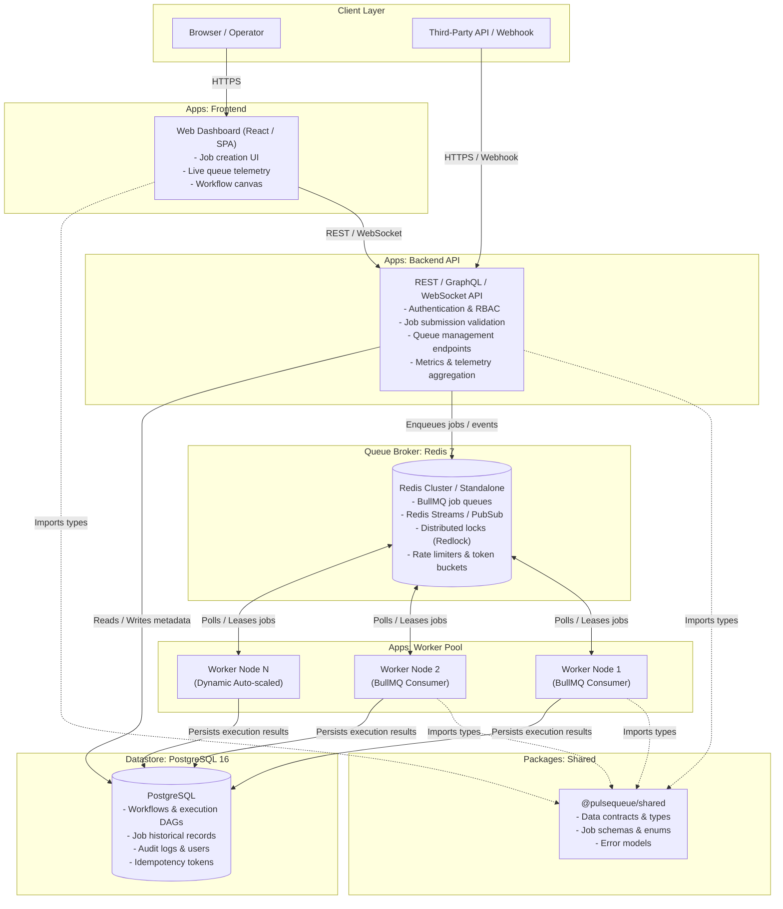

# PulseQueue Architecture Overview

## 1. Introduction

**PulseQueue** is a distributed job processing and workflow management platform engineered for resilience, horizontal scalability, and deterministic background task execution. It decouples high-throughput API ingestion from intensive compute workloads using asynchronous distributed message queues and persistent state storage.

---

## 2. System Architecture Diagram

---

## 3. Core Component Responsibilities

### 3.1 Frontend (`apps/frontend`)

- **Interactive Dashboard:** Provides a centralized control plane for platform operators and developers.
- **Queue Observability:** Displays real-time metrics including job states (`active`, `waiting`, `delayed`, `failed`, `completed`), processing rates, throughput, latency, and error rates.
- **Job Management:** Allows manual triggering, pausing, resuming, retrying failed jobs, and inspecting execution stack traces.
- **Workflow Visualization:** Visualizes directed acyclic graphs (DAGs) representing multi-step job pipelines and stage dependencies.

### 3.2 Backend API (`apps/backend`)

- **Request Ingestion & Validation:** Validates incoming payloads against contract schemas, enforces authorization/authentication policies, and prevents duplicate submissions via idempotency keys.
- **Job Scheduling & Dispatch:** Pushes job payloads into appropriate queue partitions in Redis using BullMQ producers.
- **State Queries & Projections:** Queries PostgreSQL for job histories, audit trails, and platform telemetry, serving aggregated responses to the frontend.
- **Event Streaming:** Dispatches WebSocket or Server-Sent Events (SSE) to connected clients for real-time state synchronization.

### 3.3 Worker Processes (`apps/worker`)

- **Asynchronous Execution:** Dedicated worker processes run outside the HTTP request-response lifecycle to handle compute-heavy, I/O-intensive, or delayed tasks.
- **Concurrency & Sandboxing:** Configurable concurrency per worker process with process-level isolation for task execution.
- **Lifecycle & Heartbeats:** Maintains job leases with Redis, emitting periodic progress signals to prevent dead-lock timeouts.
- **Fault Tolerance:** Implements exponential backoff retries, dead-letter queue (DLQ) routing, and grace-period handling during shutdowns.

### 3.4 Redis

- **In-Memory Queue Broker:** High-throughput, low-latency datastore backing BullMQ queues.
- **Distributed Synchronization:** Manages atomic increments, rate limiting token buckets, and distributed locks (Redlock algorithm) across distributed nodes.
- **Pub/Sub & Streams:** Distributes ephemeral notifications across backend instances and workers.

### 3.5 BullMQ (Planned Integration)

- **Queue Abstraction:** Robust, TypeScript-first message queue library built atop Redis.
- **Features Utilized:**
  - Priority queues (critical, high, normal, low).
  - Delayed and scheduled job dispatch (cron/repeatable jobs).
  - Job deduplication and rate limiting per queue.
  - Parent-child job workflows (dependencies and flow producers).
  - Automatic stalled job detection and recovery.

### 3.6 PostgreSQL

- **Permanent Relational Persistence:** Primary source of truth for all durable entities.
- **Entities Managed:**
  - Platform users, API keys, organizations, and permissions.
  - Workflow definitions, DAG configurations, and execution runs.
  - Historical job logs, execution durations, payload archives, and failure root causes.
  - Audit logging for operational compliance.
- **ACID Guarantees:** Ensures state consistency and transactional integrity across complex multi-step state mutations.

### 3.7 Shared Packages (`packages/shared`)

- **Single Source of Truth (SSOT):** Contains shared TypeScript interfaces, enums, DTO schemas, and constants.
- **Type Safety Across Boundaries:** Guarantees that the Backend API, Worker consumers, and Frontend UI adhere strictly to uniform contract definitions without drift.
- **Zero Runtime Bloat:** Emits lightweight, compiled declarations that can be referenced by Node.js microservices and browser clients alike.

---

## 4. Communication & Security Principles

1. **Network Segregation:** Data stores (PostgreSQL and Redis) reside inside a private Docker bridge network (`pulsequeue-network`). Public ingress is strictly limited to HTTP/WebSocket ports on the API and frontend.
2. **Stateless Compute:** Backend API servers and Worker processes are designed to be stateless, facilitating horizontal scaling under load.
3. **Decoupled Failure Domains:** A failure in an individual worker process or third-party downstream service does not crash the API gateway or compromise queue integrity.
